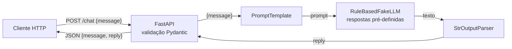

# Parte 2 – Questão 1: Chatbot simples com LangChain + Fake LLM (FastAPI)

Protótipo de chatbot que recebe texto via FastAPI e responde usando um **Fake LLM** do LangChain
(sem rede, sem chave de API, sem custo), respondendo a perguntas pré-definidas.

## Arquitetura

Fluxo: (1) o cliente envia JSON; (2) o FastAPI valida; (3) a *chain* LCEL `prompt | llm | parser` formata o prompt;
(4) o Fake LLM procura palavras‑chave e devolve a resposta pronta; (5) o parser entrega uma `str`; (6) a API responde em JSON.

## Por que usar Fake LLM em testes?
Rápido (milissegundos), gratuito, offline, **determinístico** (testes não "flutuam"), sem limites de taxa,
e permite testar casos de borda (erros, respostas vazias) sem depender de um provedor. Como a chain só conhece a interface
do LLM, depois basta trocar `RuleBasedFakeLLM` por `ChatOpenAI`, etc. O LangChain também traz `FakeListLLM`
(lista cíclica de respostas), usado em um dos testes.

## Estrutura
```
app/
  main.py                      # app + routers
  routers/chat.py              # POST /chat
  services/fake_llm.py         # RuleBasedFakeLLM (palavra-chave -> resposta)
  services/chat_service.py     # chain: prompt | llm | parser
  models/chat.py               # schemas Pydantic
tests/test_api.py
```

## Como executar
```bash
python -m venv .venv && source .venv/bin/activate   # Windows: .venv\Scripts\activate
pip install -r requirements.txt
uvicorn app.main:app --reload
curl -X POST http://127.0.0.1:8000/chat -H "Content-Type: application/json" -d '{"message": "Qual o horário de atendimento?"}'
python -m pytest -q
```
Perguntas reconhecidas: `olá`, `seu nome`, `horário`, `preço`, `ajuda`, `tchau` (qualquer outra cai no fallback).
